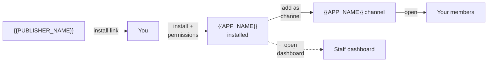
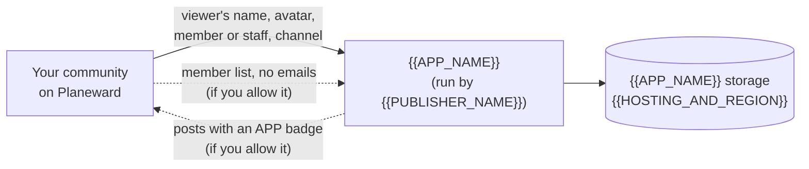

# Add {{APP_NAME}} to your community

<!--
  Guide for the communities that install your app. Before sharing it:
  - replace every {{PLACEHOLDER}};
  - describe what your app does and what it stores;
  - delete permission rows your app doesn't request, and the matching arrows in the diagrams;
  - the diagrams use Mermaid, which GitHub renders; elsewhere, render them to images or remove them;
  - delete this comment.
  Publish it wherever your users will find it (your site, a help center, or send it as-is).
-->

{{APP_NAME}} runs inside your Planeward community as a channel. {{ONE_SENTENCE_DESCRIPTION}}

For how apps work in Planeward in general, see [Apps in your community](https://docs.planeward.com/docs/community/apps).

## What you need

- A Planeward workspace with **Community** turned on (Business plan or higher).
- The **Manage community** permission in that workspace.

## Install

1. Open the install link: {{INSTALL_LINK}}
2. Check that the app is **{{APP_NAME}}** by **{{PUBLISHER_NAME}}**.
3. Pick the **Workspace** to install it in.
4. Review the permissions (see below) and select **Install {{APP_NAME}}**.

## Add it to your community

1. In Planeward, go to **Community › Apps**.
2. Open the **⋯** menu on {{APP_NAME}} and select **Add as channel**.
3. Name the channel, pick a category and select **Add channel**.

Members who can see that category now see {{APP_NAME}} in the sidebar. Staff can open the dashboard from **Community › Apps › Open dashboard**.

## Permissions we ask for

| Permission                               | Why {{APP_NAME}} needs it                                                      |
| ---------------------------------------- | ------------------------------------------------------------------------------ |
| **Community — read members**             | {{WHY_READ_MEMBERS}} (for example: show the member list on the dashboard.)     |
| **Community — post messages as the app** | {{WHY_POST_MESSAGES}} (for example: post announcements to a channel you pick.) |

You can untick a permission when installing. {{WHAT_STOPS_WORKING_WITHOUT_IT}}

## Your data

- **What Planeward tells us when a member opens the app:** their display name, avatar, whether they're a member or staff, and which channel they opened. We never receive passwords, and never receive email addresses from Planeward.
- **What we store:** {{WHAT_YOU_STORE}} (for example: posts members write in the app, kept per channel.)
- **Where it's stored:** {{HOSTING_AND_REGION}}
- **When you uninstall:** {{RETENTION_AFTER_UNINSTALL}} (for example: deleted within 30 days, or on request.)
- **Privacy policy:** {{PRIVACY_POLICY_URL}}

## Remove it

In **Community › Apps**, open the **⋯** menu on {{APP_NAME}} and select **Uninstall**. Its channels are removed and its access ends right away. Messages it already posted in your community stay.

## Help

{{SUPPORT_EMAIL_OR_URL}}
