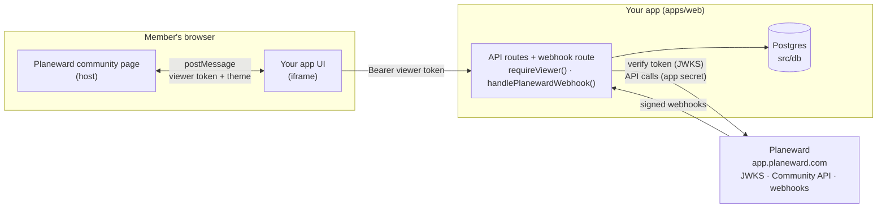
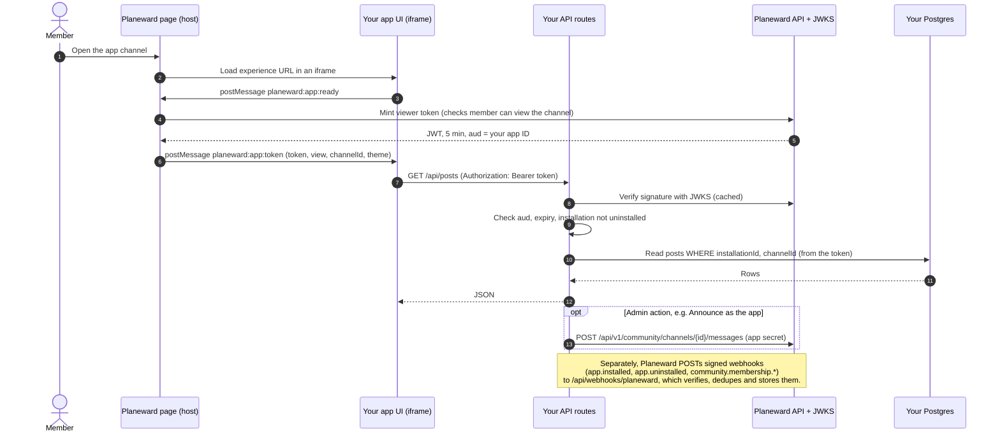

# How it works

A Planeward Community App is your own Next.js app that Planeward shows in an iframe inside a community. This page covers how this repo is put together and how a request flows through it. For the platform side (tokens, scopes, webhook events), see the [Planeward docs](https://docs.planeward.com/docs/apps).

## The repo

```
apps/
  web/                    one Planeward app (copy it to add more)
    .env.example          this app's env; copy to .env
    compose.yml           this app's local Postgres
    vercel.json           Vercel install and build commands
    drizzle.config.ts     drizzle-kit config; reads this app's .env
    drizzle/              generated migrations
    src/db/               Drizzle schema, client, DATABASE_URL
    src/lib/planeward.ts  binds requireViewer and webhooks to this app's database
    src/app/              setup page, /experience, /dashboard, API routes
packages/
  planeward/              @repo/planeward: React provider and hooks, server helpers
  ui/                     @repo/ui: shadcn/ui components and the Tailwind v4 theme
  *-config/               shared TypeScript, ESLint and Prettier configs
```

The iframe handshake, token verification, webhook verification and API client come from [`@planeward/sdk`](https://github.com/planeward/sdk) on npm. `@repo/planeward` wraps it for Next.js.

## One app, one of everything

Each folder in `apps/` is a separate Planeward app. Nothing app-specific lives at the repo root, so apps never share credentials, data or deployments. To add one, see [Adding an app](adding-an-app.md).

| Per app (`apps/<name>`)                            | Why                                                                                                    |
| -------------------------------------------------- | ------------------------------------------------------------------------------------------------------ |
| Planeward app (id, secrets, URLs)                  | Viewer tokens are checked against one app id (`aud`); webhooks are signed with one secret per app      |
| `.env` (local), Vercel project env vars (deployed) | Holds that app's id, secrets and `DATABASE_URL`                                                        |
| `compose.yml`                                      | Its own local Postgres, with its own Compose project `name`, host port and volume                      |
| `src/db`, `drizzle/`                               | Its own schema and migrations                                                                          |
| `src/lib/planeward.ts`                             | Passes its database to `createPlanewardServer`                                                         |
| Port in `package.json`                             | `pnpm dev` runs every app at once, so each needs its own port (and its own tunnel)                     |
| `vercel.json`                                      | Deployed as its own Vercel project with Root Directory `apps/<name>` ([guide](deploying-to-vercel.md)) |

Shared code lives in `packages/`. `@repo/planeward` never imports a database. It gets storage through `createPlanewardServer(store)`, which each app calls once.

## Where things run



In development, Planeward reaches your machine through a tunnel: `https://<tunnel>` forwards to `http://localhost:3005`, which serves both the iframe pages and the API routes. In production, it's your deployed URL.

## One request, step by step



1. **Handshake.** The page loads in the iframe and `PlanewardProvider` does a `postMessage` handshake with the host. The host returns the context, theme and a short-lived **viewer token**, a JWT signed by Planeward with `aud` set to your app id. See [postMessage protocol](https://docs.planeward.com/docs/apps/protocol).
2. **Viewer token.** `useViewerFetch()` sends that token as `Authorization: Bearer <token>` on every call to your own API, and the SDK refreshes it before it expires. Cookies aren't used: browsers block them in cross-origin iframes. See [Identity token](https://docs.planeward.com/docs/apps/identity).
3. **`requireViewer`.** Every API route starts with `requireViewer(request)` from `@/lib/planeward` (`{ role: "admin" }` for staff-only routes). It verifies the token against `PLANEWARD_BASE_URL` and `PLANEWARD_APP_ID`, rejects installations recorded as uninstalled, and returns the claims or a 401/403 response.
4. **Scoping.** `installationId`, `channelId` and the author (`sub`) come **only** from the verified claims. All data (for example the Board `posts`) is read and written by those ids, so one community can never see another's data.
5. **API calls.** `planewardForViewer(viewer)` builds a Planeward API client for the claims' installation, authenticated with `PLANEWARD_APP_SECRET`. What it can do depends on the scopes the installer approved. See [API access](https://docs.planeward.com/docs/apps/api).
6. **Webhooks.** `/api/webhooks/planeward` calls `handlePlanewardWebhook`. It verifies the signature on the raw body, dedupes on `x-planeward-delivery`, records installs and uninstalls, then calls your `onEvent`. If your handler throws, the delivery is released so Planeward's retry is processed again. See [App webhooks](https://docs.planeward.com/docs/apps/webhooks).

## Storage

`src/lib/planeward.ts` passes a small store to `createPlanewardServer`, backed by two tables in `src/db/schema.ts`:

| Store method         | Table                | Used for                                                                       |
| -------------------- | -------------------- | ------------------------------------------------------------------------------ |
| `isUninstalled`      | `installations`      | `requireViewer` cuts off tokens for an uninstalled installation right away     |
| `updateInstallation` | `installations`      | Records `app.installed` / `app.uninstalled`, serialized per installation       |
| `claimDelivery`      | `webhook_deliveries` | Skips a delivery that was already handled (Planeward retries with the same id) |
| `releaseDelivery`    | `webhook_deliveries` | Lets a failed delivery be processed again on retry                             |

Your own tables (like the Board's `posts`) sit next to them. After changing the schema, run `pnpm db:generate` to create a migration.

## Env and config

| Variable                   | Required | What it is                                                                      |
| -------------------------- | -------- | ------------------------------------------------------------------------------- |
| `PLANEWARD_APP_ID`         | Yes      | App id from **Settings › Apps › Developer**; viewer tokens must have this `aud` |
| `PLANEWARD_APP_SECRET`     | Yes      | App secret (`pwa_…`) for the Planeward API. Server only                         |
| `PLANEWARD_WEBHOOK_SECRET` | Yes      | Signing secret for `x-planeward-signature`. Server only                         |
| `DATABASE_URL`             | Yes      | This app's Postgres                                                             |
| `PLANEWARD_BASE_URL`       | No       | Defaults to `https://app.planeward.com`                                         |
| `ALLOWED_DEV_ORIGINS`      | Dev only | Tunnel hostname(s), comma-separated, no `https://`. Leave unset in production   |

The values come from a different place locally and on Vercel:

|             | Local                                                                         | Vercel                                                                            |
| ----------- | ----------------------------------------------------------------------------- | --------------------------------------------------------------------------------- |
| Values      | `apps/<name>/.env`                                                            | The project's environment variables                                               |
| Next.js     | Loads `.env` from the app folder before it evaluates `next.config.ts`         | Reads the project env at build and runtime                                        |
| drizzle-kit | `drizzle.config.ts` loads `.env` when `DATABASE_URL` isn't already set        | Uses `DATABASE_URL` from the build env                                            |
| Turborepo   | Hashes `.env*` into `build`; passes the variables through to `dev` and `db:*` | Not involved: `vercel.json` runs the app's own `pnpm db:migrate` and `pnpm build` |
| Postgres    | `pnpm db:up` starts the app's `compose.yml`                                   | Your provider (for example Neon from the Vercel Marketplace)                      |

`next build` validates the required variables (except when `SKIP_ENV_VALIDATION=1`, which CI uses), so a deploy fails fast when one is missing.

## Local Postgres

Each app's `compose.yml` runs Postgres 18 under its own Compose project `name` (`planeward-app-web`), with its own volume and host port (5433 for `apps/web`, leaving 5432 for a Planeward checkout).

- `pnpm db:up` runs `docker compose up -d --wait` in every app and returns once each database is healthy. Use `pnpm --filter @repo/<name> db:up` for one app.
- `pnpm db:migrate` applies each app's migrations to its own database.
- To stop an app's database, run `docker compose down` in its folder. Add `-v` to delete its data too.
